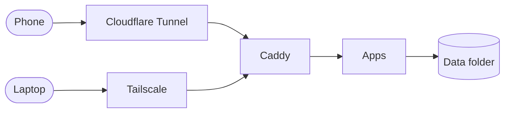

One small always-on machine running files, photos, notes and a few home-made apps. This note is the single place that explains how it fits together.

## Overview

> [!info] Design rules
> No open router ports, flat files over databases, one reverse proxy in front of everything.

## Hardware

| Item | Value |
|---|---|
| Machine | Small form-factor PC |
| CPU | 6 cores |
| RAM | 16 GB |
| Disk | 2 TB NVMe |

## Backups

1. Nightly snapshot of the data folder.
2. Weekly copy to an external disk.

> [!warning] Test a restore
> A backup you have never restored is only a hope.
